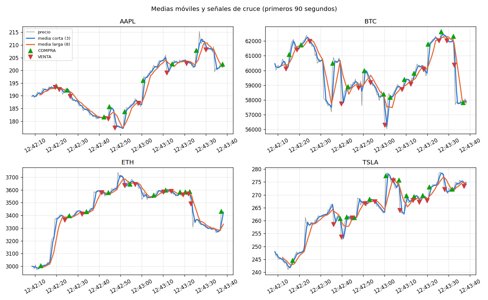
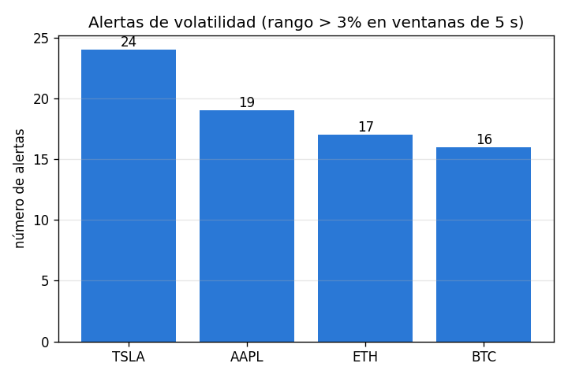
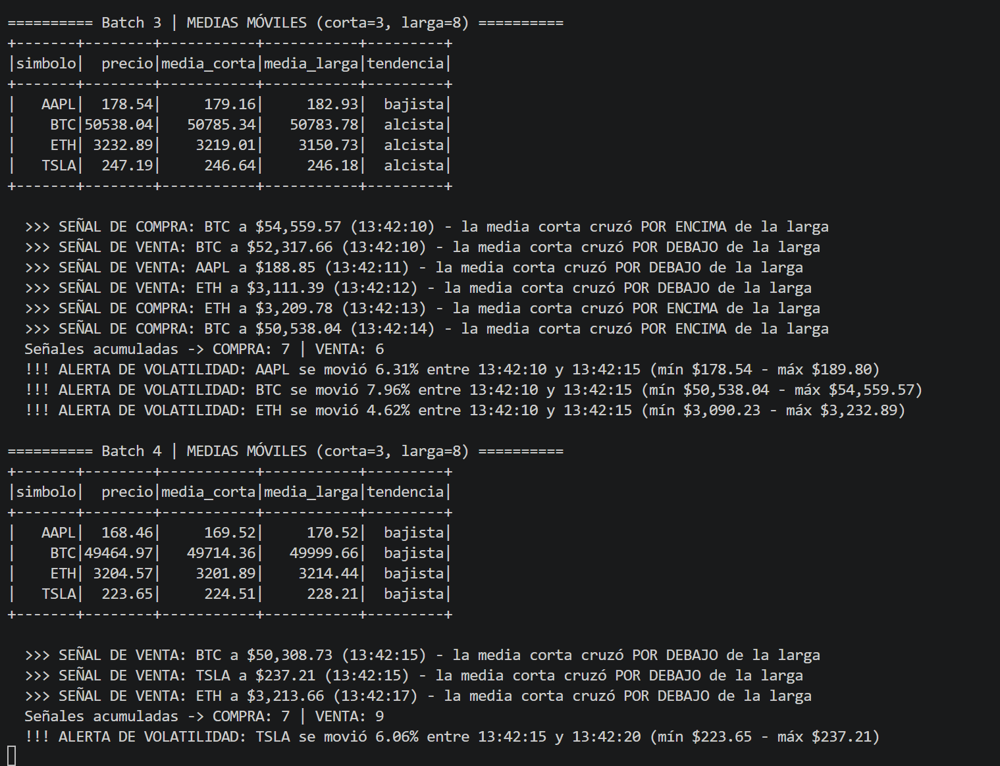

# Trabajo 3 - Pipeline de streaming en tiempo real

Caso C: Monitoreo de precios de acciones/cripto

Integrantes: Emanuel Quintero y Tomas Posada

Big Data - Alejandro Mery Agudelo - Octubre 2026

# 1. Cómo funciona

- El productor del profe (productor_precios.py) manda cada 0,5 segundos un precio de BTC, ETH, AAPL y TSLA al topic precios de Kafka.
- Kafka corre en Docker con el mismo docker-compose de la Clase 12. El script iniciar.sh lo levanta y crea el topic con 1 partición para que los precios lleguen en orden.
- detector.py lee el topic con Spark Structured Streaming y el conector spark-sql-kafka, pasa el JSON a columnas con from_json y usa el timestamp de Kafka como hora del precio, porque el evento no la trae.
- El detector corre dos consultas al tiempo, cada una con un micro-batch cada 5 segundos: una para las reglas 1 y 3 y otra para la regla 2.
- Todo lo que detecta sale en la consola y se guarda en CSV en la carpeta resultados. Con esos CSV, resumen.py responde las preguntas de negocio y hace las gráficas.

# 2. Reglas

## Regla 1 - Medias móviles

- Por cada símbolo, la media corta es el promedio de los últimos 3 precios y la media larga el de los últimos 8.
- Se calculan con window functions (avg con rowsBetween), pero estas no funcionan directo sobre un stream, así que usamos foreachBatch como sugería el enunciado.
- Cada batch trae pocos precios, entonces guardamos un historial con los últimos 8 precios de cada símbolo y lo juntamos con el batch siguiente para que las medias no se corten.
- En cada batch sale un panel con el último precio, las dos medias y si la tendencia es alcista o bajista.

## Regla 2 - Volatilidad

- Agrupamos los precios de cada símbolo en ventanas de tiempo de 5 segundos (window, como en la Clase 12) y sacamos el mínimo y el máximo.
- Si (máximo - mínimo) / mínimo pasa de 3%, sale una alerta de volatilidad.
- Usamos watermark de 5 segundos y modo update para que la alerta salga apenas se pasa el 3%, sin repetir la misma ventana.

## Regla 3 - Cruce de medias

- Calculamos la diferencia entre la media corta y la larga y la comparamos con la del precio anterior usando lag.
- Si la diferencia pasa de negativa a positiva es señal de COMPRA, y si pasa de positiva a negativa es señal de VENTA.
- Para comprobar, recalculamos las medias y los cruces con pandas y dieron exactamente igual.

# 3. Resultados

Corrimos el pipeline 5 minutos (7 de octubre, de 12:42 a 12:47) y se procesaron 2.344 precios en 61 micro-batches.

## Medias móviles

- La media corta sigue el precio casi pegada y la larga es más suave pero va atrasada.

## Volatilidad

- 76 alertas, más o menos 1 de cada 3 ventanas de 5 segundos.
- TSLA tuvo 24 alertas, AAPL 19, ETH 17 y BTC 16.
- El salto más grande fue de ETH: 10,17% en 5 segundos.

## Cruce de medias

- 307 señales: 154 de COMPRA y 153 de VENTA.
- Por símbolo: BTC 82, TSLA 77, ETH 76 y AAPL 72.
- Son unas 62 señales por minuto, y la mitad de las veces la señal contraria llegó en menos de 3,1 segundos.

# 4. Preguntas de negocio

## ¿Qué símbolo fue más volátil?

- Por número de alertas fue TSLA (24). Por tamaño de los movimientos fue ETH, que tuvo el salto más grande (10,17%) y la mayor variación entre un precio y el siguiente (0,94%).
- La diferencia entre los cuatro es pequeña porque el productor los simula con la misma fórmula, así que si lo volvemos a correr puede quedar otro de primero.

## ¿Cuántas señales de compra/venta se generaron?

- 307 en 5 minutos: 154 de compra y 153 de venta.
- Son demasiadas. La mayoría son señales falsas por el ruido: el precio salta, las medias se cruzan y enseguida el precio se devuelve y sale la señal contraria.

## ¿Confiaríamos en esta estrategia con dinero real?

- No. Simulamos comprar en cada COMPRA y vender en la siguiente VENTA y el resultado fue: AAPL +1,6%, BTC -16,2%, ETH +24,7% y TSLA -5,1%, o sea +1,3% en promedio, y solo el 40% de las operaciones fueron ganadoras.
- Comprar al principio y no hacer nada daba +14% en promedio.
- Con una comisión de 0,2% por operación (hicimos 154) el promedio queda en -6,4%, o sea que se pierde plata.
- Las medias son muy cortas: 3 y 8 precios son 1,5 y 4 segundos, entonces cualquier movimiento genera un cruce.
- La señal llega tarde: compra después de que el precio ya subió y vende después de que ya bajó.
- Los precios del productor son una caminata aleatoria, así que el pasado no sirve para predecir el futuro; que ETH saliera positivo fue suerte.
- 5 minutos son muy pocos datos para confiar en una estrategia.
- Lo que sí sirve es el monitoreo (panel y alertas). Antes de poner plata usaríamos medias más largas, stop-loss, datos históricos reales y primero paper trading.

# 5. Evidencia en vivo

# 6. Retos técnicos

- Git Bash: el docker exec para crear el topic fallaba porque Git Bash convierte la ruta /opt/kafka en una ruta de Windows. Se arregló con MSYS_NO_PATHCONV=1 en iniciar.sh.
- Conector: tiene que coincidir con la versión de Spark (pyspark 4.2.0 usa Scala 2.13), así que armamos el nombre del paquete con la versión de pyspark instalada.
- Window functions: no funcionan en streaming, por eso usamos foreachBatch con el historial de los últimos 8 precios.
- Lentitud: al principio creábamos el historial con spark.createDataFrame en cada batch y en Windows eso lanzaba muchos procesos de Python y se volvía lentísimo. Lo cambiamos por localCheckpoint().
- Ventana de volatilidad: con ventanas de 10 segundos unas 4 de cada 5 daban alerta solo por el movimiento normal del precio. Con 5 segundos las alertas sí corresponden a saltos bruscos.
